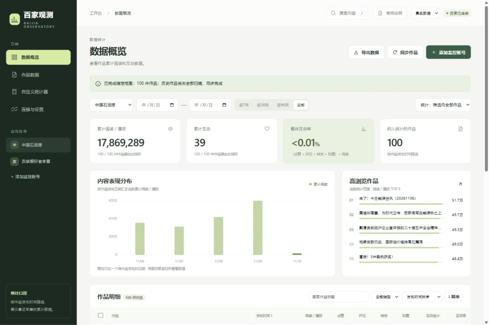
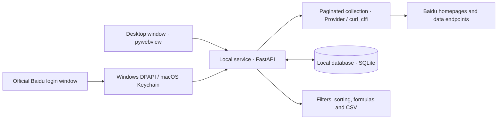

# Baijia Observatory · 百家观测

[简体中文](README.md) | **English**

A desktop workspace for Baijiahao content analytics. Add authors by their homepage URLs, collect views and interactions, then filter, rank, calculate and export results by author, publication date or selected works.

Current version: **1.1.0**, with installers for Windows x64, Apple Silicon Macs and Intel Macs. The runtime is bundled. The app opens directly into a local workspace. The desktop interface uses Simplified Chinese; this guide includes the corresponding UI labels.

[Download installers](https://github.com/mrg1130/private/releases/latest) · [12-page illustrated guide, in Chinese](studio/manual.pdf) · [License](LICENSE) · [Upstream and third-party notices](THIRD_PARTY_NOTICES.md)



The screenshot shows a collection of 100 recent works from 中国石油报, captured on November 10, 2026.

## Installation

| Platform | Installer |
| --- | --- |
| Windows 64-bit | [Windows-x64-Setup.exe](https://github.com/mrg1130/private/releases/download/v1.1.0/BaijiaObservatory-1.1.0-Windows-x64-Setup.exe) |
| Apple Silicon Mac | [macOS-arm64.pkg](https://github.com/mrg1130/private/releases/download/v1.1.0/BaijiaObservatory-1.1.0-macOS-arm64.pkg) |
| Intel Mac | [macOS-x86_64.pkg](https://github.com/mrg1130/private/releases/download/v1.1.0/BaijiaObservatory-1.1.0-macOS-x86_64.pkg) |

- **Windows:** Run the installer, then open 百家观测 from the desktop or Start menu. The installer checks for Microsoft WebView2 and installs the runtime when needed.
- **Mac:** Run the package for your processor, then open 百家观测 from Applications. Check the processor under Apple menu → About This Mac. If macOS requests developer confirmation during the first installation, select Open Anyway under System Settings → Privacy & Security.

The release page is in a private repository; download using a GitHub account with access to it. The 使用说明 button at the top right opens the bundled PDF.

## Quick start

1. Open 连接与设置 (Connections & Settings), then select 打开百度官方登录窗口 (Open the official Baidu login window). Use QR code, SMS, account/password or another method offered by the official page. Wait for 百度已连接 (Baidu connected).
2. Select 添加监控账号 (Add monitored author), paste a Baijiahao author homepage URL and select 识别并添加 (Identify and add). Example: [中国石油报](https://author.baidu.com/home/1595713367276134).
3. Choose 全部历史作品 (All historical works) or the latest 100 / 500 / 1000 works and start syncing. The task displays page count, processed works and completion status.
4. In 数据概览 (Overview) or 作品数据 (Works), select an author and publication date range. Sort by views, interactions or a custom formula. 高浏览作品 (Most-viewed works) shows the top five by views within the current statistical scope.
5. Optionally check individual works and enable 仅统计手选作品 (Selected works only). Create a calculator or select 导出数据 (Export data) to generate a CSV.

Authors are added using `https://author.baidu.com/home/NUMERIC_ID`. 搜索内容 (Content search) searches collected works and optionally Baidu's online content index. When online search presents a verification page, complete it in the official Baidu window opened by the app, then search again.

## Features

| Feature | Behavior |
| --- | --- |
| Author monitoring | Identify an author from a homepage URL; save name, follower count, publication count and collected works |
| Work collection | Read paginated results and update works by ID; collect full history or a selected recent count, and stop running tasks |
| Content search | Search local titles and keywords, or Baidu's public content index |
| Scope filters | Combine author, publication date, keyword, work type and manual selection |
| Rankings and sorting | Top five most-viewed works; sort details by publication time, base metrics or custom results in either direction |
| Custom calculators | Save, edit and delete formulas, select aggregation methods and inspect eligible-work counts |
| CSV export | Export the current scope's base metrics and per-work formula values as Excel-compatible UTF-8 with BOM |
| Demo data | Switch to a separate dataset of 3 fictional authors and 144 works |

## Metric definitions

- Date filters use each work's **publication date in Beijing time (UTC+8)**, including both endpoints. Charts group works by publication date. Values are **cumulative readings from the latest sync**.
- Interactions equal likes + comments + shares + favorites. Overall engagement rate uses works with both views and complete interaction data: sum of interactions ÷ sum of views × 100%.
- `0` is a known zero; `—` is a missing value. Statistic cards show eligible-work counts. Empty CSV fields represent missing values.
- Selected-work statistics and exports use the intersection of checked works and the current author, date, keyword and other filters.
- 同步完成 (Sync complete) means the final page was reached and required metrics are complete. 指定范围完成 (Selected range complete) means the requested count was processed. Task messages describe other states and unfinished collection.

### Custom calculators

Formulas support numbers, parentheses, addition, subtraction, multiplication and division, with these variables:

| Variable | Metric |
| --- | --- |
| `views` | Reads / plays |
| `likes` | Likes |
| `comments` | Comments |
| `shares` | Shares |
| `favorites` | Favorites |
| `interactions` | Likes + comments + shares + favorites |
| `live_views`, `unread` | Additional live replay and unread fields returned by the platform, available to formulas |

| Goal | Formula | Aggregation |
| --- | --- | --- |
| Average views | `views` | Evaluate each work, then average |
| Weighted interaction score | `likes + comments * 2 + shares * 3 + favorites * 2` | Evaluate each work, then sum |
| Overall engagement rate | `interactions / views * 100` | Aggregate metrics first, then evaluate |

Per-work maximum and minimum are also supported. Missing inputs or division by zero produce `—`. Aggregate-first formulas use the same set of works with all required inputs available.

## How it works



The desktop app selects a loopback port automatically. Sync tasks read the author profile, paginated works and per-work interactions, saving each result to SQLite. Later syncs update existing works. The interface, calculators and export share the same filters. Closing the desktop window stops the local service.

## Local data

| Mode | Data directory |
| --- | --- |
| Installed Windows app | `%LOCALAPPDATA%\BaijiaObservatory` |
| Installed Mac app | `~/Library/Application Support/BaijiaObservatory` |
| Source development | `.local/` in the project root |

Authors, works, tasks and calculators are stored in `studio.sqlite3`. Windows protects connection credentials with DPAPI; Mac uses Keychain. To back up data, close the app and copy the data directory. Reconnect Baidu after moving to a new computer.

## Development and validation

Development and CI use **Python 3.13**. Run these commands from the project root.

### Windows PowerShell

```powershell
python -m venv .venv
.\.venv\Scripts\python.exe -m pip install -r requirements-desktop.txt
.\.venv\Scripts\python.exe desktop.py
```

### macOS

```bash
python3 -m venv .venv
.venv/bin/python -m pip install -r requirements-desktop.txt
.venv/bin/python desktop.py
```

### Browser development mode and tests

Use `.\.venv\Scripts\python.exe` on Windows or `.venv/bin/python` on Mac to run:

```text
<venv-python> -m studio.server --open
<venv-python> -m unittest discover -s tests -v
```

Browser development mode opens `http://127.0.0.1:8765` by default; set the port with `--port`. Set `BAIJIA_DATA_DIR` to give a development process a separate data directory.

Tests cover homepage entry, connection state, pagination and completion states, date and selection filters, formulas, CSV, legacy workspace migration and native webview result handling on Windows and Mac. Version 1.1.0 has passed an actual Windows installation check and installation, local-service and desktop-rendering checks on both Mac architectures.

### Original API

`baidu_apis.py` retains the `BaiduApis` methods `get_user_info`, `get_user_posted`, `get_work_info` and `check_cookies_alive`. The desktop collector adapter is in `studio/provider.py`. API calls use Baidu connection credentials containing `BDUSS` and `Hmery-Time`.

## Building installers and releases

### Windows installer

```powershell
.\.venv\Scripts\python.exe -m pip install -r requirements-build.txt
.\.venv\Scripts\python.exe packaging/build_windows.py
```

### Mac installer

```bash
source .venv/bin/activate
python -m pip install -r requirements-build.txt
bash packaging/build_macos.sh
```

Build on the corresponding operating system. Outputs are written to `release/`. Windows uses PyInstaller and the built-in IExpress utility. Mac uses PyInstaller, ad hoc code signing and `pkgbuild`, with a fixed `/Applications` installation location.

The [Desktop installers workflow](.github/workflows/installers.yml) runs manually or on pushes to `desktop-installers`. It builds Windows, Mac ARM64 and Mac Intel installers separately, then publishes the installers and PDF after success. Before a new release, update the version and release tag across the desktop entry point, local service, packaging configuration and workflow. Each version tag corresponds to one release.

Documentation-only commits may include `[skip ci]` in their commit message.

## Project layout

```text
desktop.py                 Desktop entry point and startup checks
baidu_apis.py              Upstream base API
studio/
  server.py                Local API, collection tasks and export
  provider.py              Baidu response adapters, profiles and pagination
  browser_login.py         Baidu connection for browser development mode
  native_login.py          Official login window in the desktop app
  desktop_js.py            Cross-platform webview snapshots
  storage.py               SQLite, credentials and workspace migration
  metrics.py               Metric definitions and formula evaluation
  web/                     Workspace interface
  manual.pdf               Bundled illustrated guide
packaging/                 Icons, installers and build scripts
tests/                     Automated tests
docs/images/               README screenshots
.github/workflows/         Cross-platform builds and releases
```

## Documentation maintenance

Keep `README.md` and `README.en.md` aligned on features, installers, commands and metric definitions. Update both when changing the interface, collection scope, calculations or release version. Refresh `studio/manual.pdf` and `docs/images/` when instructions or screenshots change. Update license and provenance records when adding dependencies or upstream files.

## Attribution and license

The base API comes from [cv-cat/BaijiaApis](https://github.com/cv-cat/BaijiaApis), at baseline commit [`2c3d552`](https://github.com/cv-cat/BaijiaApis/tree/2c3d55253fe2c4ea3811bb95a9bcbaf64cd1c165).

Original code and documentation added by this project are covered by the [MIT License](LICENSE). Inherited upstream code and dependencies retain their respective rights and terms. See [THIRD_PARTY_NOTICES.md](THIRD_PARTY_NOTICES.md) for file provenance and license scope.
