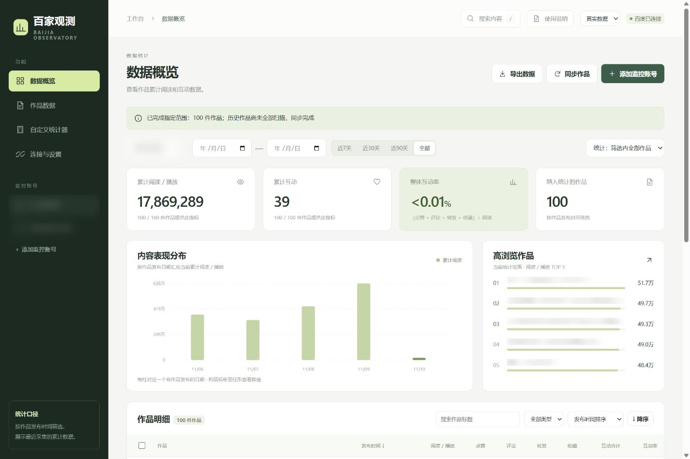
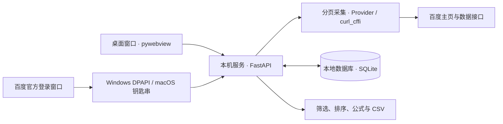

# 百家观测 · Baijia Observatory

**简体中文** | [English](README.en.md)

百家号内容数据桌面工作台。通过作者主页链接添加监控账号，采集作品的浏览和互动数据，按作者、发布日期和手选范围统计、排序并导出。

当前版本：**1.2.0**。提供 Windows x64、Mac Apple Silicon 和 Mac Intel 安装包，运行环境随安装包提供。打开软件直接进入本地工作台。

[下载安装包](https://github.com/mrg1130/Baijia-Observatory/releases/latest) · [12 页图文教程](studio/manual.pdf) · [许可证](LICENSE) · [上游与第三方说明](THIRD_PARTY_NOTICES.md)



截图展示测试账号近期 100 件作品。账号名称、头像、主页标识和作品标题已模糊化。

## 1.2.0 更新

- 采用伙伴提交的百度旧登录态修复，重新登录和断开连接时清理旧会话，重启后继续完成待处理的清理。
- 新增小型“关于”弹窗，展示应用版本、工作室 logo 和“创想澄现工作出品”。从侧栏底部或页面底部“关于”打开。

## 安装

| 平台 | 安装包 |
| --- | --- |
| Windows 64 位 | [Windows-x64-Setup.exe](https://github.com/mrg1130/Baijia-Observatory/releases/download/v1.2.0/BaijiaObservatory-1.2.0-Windows-x64-Setup.exe) |
| Mac Apple M 系列 | [macOS-arm64.pkg](https://github.com/mrg1130/Baijia-Observatory/releases/download/v1.2.0/BaijiaObservatory-1.2.0-macOS-arm64.pkg) |
| Mac Intel | [macOS-x86_64.pkg](https://github.com/mrg1130/Baijia-Observatory/releases/download/v1.2.0/BaijiaObservatory-1.2.0-macOS-x86_64.pkg) |

- **Windows：** 运行安装包，完成后从桌面或开始菜单打开“百家观测”。安装器会检查并补装 Microsoft WebView2 运行组件。
- **Mac：** 运行对应芯片的安装包，从“应用程序”打开“百家观测”。在“Apple 菜单 → 关于本机”查看芯片类型。首次安装若系统要求确认开发者，在“系统设置 → 隐私与安全性”中选择“仍要打开”。

安装包可从公开发布页下载。软件右上角“使用说明”可打开内置 PDF。

## 快速使用

1. 打开“连接与设置”，点击“打开百度官方登录窗口”。在官方页面选择扫码、短信验证码、账号密码或页面提供的其他登录方式，完成后等待显示“百度已连接”。
2. 点击“添加监控账号”，粘贴百家号作者主页链接并选择“识别并添加”。地址格式：`https://author.baidu.com/home/数字ID`。
3. 选择“全部历史作品”或近期 100 / 500 / 1000 件，开始同步。任务会显示页数、处理数量和完成状态。
4. 在“数据概览”或“作品数据”中选择作者和发布日期范围，按阅读 / 播放、互动指标或自定义公式排序。“高浏览作品”展示当前统计范围内浏览量最高的前 5 件作品。
5. 按需勾选作品，启用“仅统计手选作品”，创建统计器或点击“导出数据”生成 CSV。

监控账号通过 `https://author.baidu.com/home/数字ID` 录入。“搜索内容”检索已采集作品，也可选择百度在线内容搜索；在线搜索出现安全验证时，在软件打开的百度官方窗口完成验证后再次搜索。

## 功能

| 功能 | 操作与结果 |
| --- | --- |
| 作者监控 | 主页链接识别账号，保存昵称、粉丝数、发布量和已采集作品 |
| 作品同步 | 分页采集，按作品 ID 更新；支持全量历史、指定近期数量及停止任务 |
| 内容搜索 | 检索本地作品标题与关键词，或查询百度公开内容索引 |
| 范围筛选 | 按作者、发布日期、关键词、作品类型及手选范围组合筛选 |
| 排名与排序 | 高浏览作品前 5 名，明细按发布时间、基础指标和自定义结果升降序排列 |
| 自定义统计 | 保存、编辑和删除公式，选择汇总方式，显示有效作品数量 |
| CSV 导出 | 导出当前统计范围的基础指标和逐作品公式结果，使用 UTF-8 BOM 编码，可用 Excel 打开 |
| 演示数据 | 独立的 3 位虚构作者、144 件作品，可在数据来源中切换体验 |

## 统计口径

- 日期筛选按作品的**北京时间发布日期**判断，起止日期均包含在范围内。图表按发布日期分组，读数为作品**最后一次同步时的累计值**。
- 互动合计为点赞、评论、转发和收藏之和。整体互动率在同时具备浏览量和完整互动数据的作品中，计算“互动总和 ÷ 浏览总和 × 100%”。
- `0` 表示已知数值为零；`—` 表示该字段缺失。统计卡显示有效作品数；CSV 中的空白表示缺失值。
- 手选统计和导出取“已勾选作品”与当前作者、日期、关键词等条件的交集。
- “同步完成”表示采集到末页且必要指标完整；“指定范围完成”表示选定数量已处理。其他状态和未完成原因显示在任务消息中。

### 自定义统计器

公式支持数字、括号和加减乘除。可使用以下变量：

| 变量 | 指标 |
| --- | --- |
| `views` | 阅读 / 播放 |
| `likes` | 点赞 |
| `comments` | 评论 |
| `shares` | 转发 |
| `favorites` | 收藏 |
| `interactions` | 点赞 + 评论 + 转发 + 收藏 |
| `live_views`、`unread` | 平台返回的直播回放、未读附加字段，可在公式中使用 |

| 统计目标 | 公式 | 汇总方式 |
| --- | --- | --- |
| 平均阅读量 | `views` | 逐作品计算后取平均 |
| 加权互动得分 | `likes + comments * 2 + shares * 3 + favorites * 2` | 逐作品计算后求和 |
| 整体互动率 | `interactions / views * 100` | 先汇总指标，再计算公式 |

汇总方式还包括逐作品计算后的最大值、最小值。公式所需字段缺失或除数为零时，该结果显示为 `—`。“先汇总后计算”使用公式所需字段完整的同一组作品。

## 工作原理



桌面版使用自动选择的本机回环端口。同步任务读取作者主页、作品分页及单篇互动数据，逐件写入 SQLite；再次同步时更新同一作品。界面、统计器和导出使用相同的筛选条件。桌面窗口关闭时结束本机服务。

## 数据保存

| 场景 | 数据目录 |
| --- | --- |
| Windows 安装版 | `%LOCALAPPDATA%\BaijiaObservatory` |
| Mac 安装版 | `~/Library/Application Support/BaijiaObservatory` |
| 源码开发版 | 项目根目录下的 `.local/` |

监控账号、作品、任务和统计器保存在 `studio.sqlite3` 中。Windows 使用系统 DPAPI 加密连接凭据，Mac 使用钥匙串。备份时关闭软件，再复制数据目录；迁移到新电脑后重新连接百度。

## 开发与验证

开发和 CI 使用 **Python 3.13**。在项目根目录执行以下命令。

### Windows PowerShell

```powershell
python -m venv .venv
.\.venv\Scripts\python.exe -m pip install -r requirements-desktop.txt
.\.venv\Scripts\python.exe desktop.py
```

### macOS

```bash
python3 -m venv .venv
.venv/bin/python -m pip install -r requirements-desktop.txt
.venv/bin/python desktop.py
```

### 浏览器开发模式与测试

Windows 使用 `.\.venv\Scripts\python.exe`，Mac 使用 `.venv/bin/python` 执行：

```text
<venv-python> -m studio.server --open
<venv-python> -m unittest discover -s tests -v
```

浏览器开发模式默认打开 `http://127.0.0.1:8765`，可用 `--port` 指定端口。设置 `BAIJIA_DATA_DIR` 可为开发进程指定独立数据目录。

测试覆盖主页录入、连接状态、分页和完成状态、日期与手选筛选、公式、CSV、旧工作台迁移及 Windows / Mac 网页脚本结果适配。发布流程还检查打包后的本机服务、桌面界面、关于入口和内置 logo，并在两种 Mac 架构上验证安装。

### 原始接口

`baidu_apis.py` 保留 `BaiduApis` 类的 `get_user_info`、`get_user_posted`、`get_work_info` 和 `check_cookies_alive` 方法。桌面采集适配位于 `studio/provider.py`。接口调用使用包含 `BDUSS` 和 `Hmery-Time` 的百度连接凭据。

## 打包与发布

### Windows 安装包

```powershell
.\.venv\Scripts\python.exe -m pip install -r requirements-build.txt
.\.venv\Scripts\python.exe packaging/build_windows.py
```

### Mac 安装包

```bash
source .venv/bin/activate
python -m pip install -r requirements-build.txt
bash packaging/build_macos.sh
```

在对应操作系统构建，产物位于 `release/`。Windows 使用 PyInstaller 和系统自带 IExpress；Mac 使用 PyInstaller、ad hoc 代码签名和 `pkgbuild`，固定安装到 `/Applications`。

[Desktop installers 工作流](.github/workflows/installers.yml) 支持手动运行，或由 `desktop-installers` 分支推送触发：Windows、Mac ARM64 和 Mac Intel 分别构建，通过后发布安装包和 PDF。发布新版本时，同步更新桌面入口、本机服务、打包配置和工作流中的版本号与发布标签；每个版本标签对应一次发布。

仅更新文档的提交可在提交信息中使用 `[skip ci]`。

## 项目结构

```text
desktop.py                 桌面入口与启动检查
baidu_apis.py              上游基础接口
studio/
  server.py                本机 API、采集任务与导出
  provider.py              百度响应适配、主页解析与分页
  browser_login.py         浏览器开发模式的百度连接
  native_login.py          桌面版官方登录窗口
  desktop_js.py            跨平台网页快照读取
  storage.py               SQLite、凭据存储与工作台迁移
  metrics.py               指标口径与公式计算
  web/                     工作台页面
  manual.pdf               内置图文教程
packaging/                 图标、安装器与构建脚本
tests/                     自动化测试
docs/images/               README 截图
.github/workflows/         跨平台构建与发布
```


## 来源与许可证

基础接口来自 [cv-cat/BaijiaApis](https://github.com/cv-cat/BaijiaApis)，检出版本为 [`2c3d552`](https://github.com/cv-cat/BaijiaApis/tree/2c3d55253fe2c4ea3811bb95a9bcbaf64cd1c165)。

本项目新增的原创代码和文档采用 [MIT License](LICENSE)。继承的上游代码及依赖保留各自的权利与条款，具体文件和许可范围见 [THIRD_PARTY_NOTICES.md](THIRD_PARTY_NOTICES.md)。
